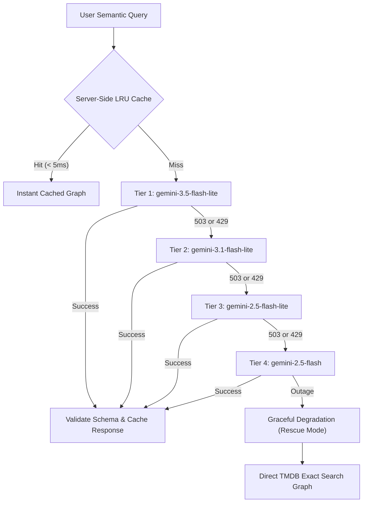

# CineScope

CineScope is an offline-first cinematic tracking and discovery platform built with Angular 19, Ionic 8, and Capacitor 7, powered by a high-resilience Google Gemini AI orchestration gateway and a Node.js serverless Backend-for-Frontend (BFF) on Vercel.

## Core Architectural Highlight: Gemini AI Orchestration Engine

Instead of acting as a simple LLM wrapper, CineScope employs Google Gemini as a semantic intent compiler. It translates conversational, ambiguous natural-language queries into multi-parameter TMDB Discover API Execution Graphs in sub-second latency.

For example, a query such as:
> *"mind-bending sci-fi movies where time slows down near a black hole with matthew mcconaughey"*

is parsed by Gemini into an executable JSON parameter graph:
```json
{
  "sections": [
    {
      "title": "Matthew McConaughey Sci-Fi Mindbenders",
      "action": "discover_movies",
      "parameters": {
        "person_name": "Matthew McConaughey",
        "genres": [878],
        "keywords": ["time dilation", "black hole"],
        "sort_by": "popularity.desc"
      }
    }
  ]
}
```
The client execution engine concurrently resolves TMDB entity IDs and renders responsive, infinite-scrolling title feeds.

### Production AI Resilience Architecture

To prevent user-facing downtime during upstream AI traffic spikes or Google regional demand surges (HTTP 503 / 429), the gateway runs an automated 4-tier resilience pipeline:



### Engineering Highlights

- Zero Token Waste: A 2-hour TTL in-memory LRU cache serves frequent searches in under 5ms, eliminating redundant upstream invocations.
- Automated Cascading Fallback: Seamlessly shifts between high-throughput models (Gemini 3.5 Flash Lite -> 3.1 Flash Lite -> 2.5 Flash Lite -> 2.5 Flash) if upstream capacity throttles.
- Zero-Downtime Graceful Degradation: If all AI tiers fail, the engine automatically falls back to an exact-match execution graph so users receive search results without interruption.
- Prompt Isolation & Security: Native role separation via Google Generative AI SDK `systemInstruction` parameters prevents prompt injection and parameter hallucination.
- Credential Security: Third-party API credentials (TMDB access tokens and Gemini API keys) are fully isolated within the Vercel BFF and never exposed to the client bundle.

## Monorepo Layout

This repository is managed as a monorepo via PNPM Workspaces:

- `cinescope/`: Cross-platform mobile app (Angular 19 Signals, Ionic 8, Capacitor 7, RxDB persistent local database).
- `cinescope-api/`: Serverless Backend-for-Frontend gateway (Vercel functions, rate limiting, SSRF guard, Gemini orchestration).
- `docs/`: Docusaurus technical documentation hub and OpenAPI specifications.

## Prerequisites

- Node.js >= 22.0.0
- pnpm >= 10.0.0
- Java JDK 21 (for Android builds)
- Android SDK Platform 34+

## Getting Started

### 1. Installation

Install all workspace dependencies from the repository root:

```bash
pnpm install
```

### 2. Local Development

Run the API gateway (port 3000) and the Angular UI development server concurrently:

```bash
pnpm run dev
```

Or run services individually:

- Frontend UI: `pnpm --filter cinescope start`
- Backend API: `pnpm --filter cinescope-api exec npx vercel dev --listen 3000 --yes`

### 3. Production Build

Compile all workspace packages:

```bash
pnpm run build
```

Frontend production assets are generated in `cinescope/www/`.

### 4. Native Android Build and Deployment

Sync web assets to Capacitor and launch on a connected Android device or emulator:

```bash
cd cinescope
npx cap sync android
npx cap run android
```

Alternatively, use root convenience scripts:

```bash
pnpm run android:dev   # Live-reload mode
pnpm run android:prod  # Production bundle mode
```

## Security & Gateway Defenses

The serverless gateway (`cinescope-api`) enforces strict security policies on all traffic:
- Client Origin Verification: Enforces `X-Cinescope-Client: CS-Mobile-App-2026` headers.
- Path Traversal Guard: Sanitizes TMDB routes and rejects traversal patterns (`..`, `%2e`).
- Prefix Allowlist: Restricts TMDB proxy traffic strictly to 17 read-only prefixes.
- SSRF Protection: Blocks private IP ranges, link-local addresses, cloud metadata (169.254.169.254), and non-HTTPS targets on feed endpoints.
- Rate Limiting: In-memory sliding-window limiter per IP to mitigate denial-of-service attempts.

Detailed endpoint specifications, JSON schemas, and API documentation are available in [`cinescope-api/README.md`](cinescope-api/README.md).

## Documentation Hub

Build and preview the complete documentation portal:

```bash
pnpm run docs:start
```
