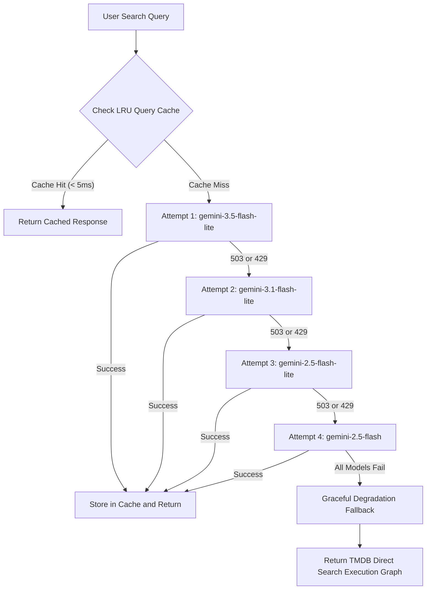

# CineScope API (Backend-for-Frontend)

Serverless API gateway for the CineScope mobile application. Secures upstream API credentials (TMDB, Google Gemini) and provides rate limiting, server-side caching, and threat protection.

## Architecture

- Platform: Vercel Serverless Functions (Node.js 22+ / 24 runtime)
- Language: TypeScript (strict mode)
- Authentication: Requires `X-Cinescope-Client: CS-Mobile-App-2026` header on all protected routes.
- Rate Limiting: Sliding-window in-memory limiter per client IP.

## Endpoints

### 1. GET /api/tmdb
Reverse proxy for The Movie Database (TMDB) API v3.
- Security: Enforces read-only prefix allowlist (17 paths: `/movie/`, `/tv/`, `/person/`, `/discover/`, `/search/`, `/keyword/`, etc.) and rejects directory traversal (`..`, `%2e`).
- Headers: `X-TMDB-Path` (target path, e.g. `/movie/popular`) or query parameter `path`.
- Rate Limit: 120 requests per minute per IP.

### 2. POST /api/smart-search
Translates natural-language user queries into TMDB Discover API execution graphs.
- Body: `{ "query": string, "models"?: string[] }`
- Rate Limit: 25 requests per minute per IP.
- Resilience: Uses a 4-tier mitigation strategy against upstream AI outages and spikes.

#### 4-Tier Mitigation Strategy



1. Query Cache: 2-hour TTL in-memory LRU cache serves identical queries in under 5ms, consuming zero token quota.
2. Cascading Model Fallback: Prioritizes models by quota capacity (Gemini 3.5 Flash Lite -> Gemini 3.1 Flash Lite -> Gemini 2.5 Flash Lite -> Gemini 2.5 Flash). Automatically shifts tiers on HTTP 503 (high demand) or HTTP 429 (quota exceeded).
3. Graceful Degradation: If all AI tiers fail, automatically returns a direct TMDB exact-match execution graph so users still receive movie results instead of a 500 error.
4. Structured Status Propagation: Unrecoverable failures return HTTP 503 with a `Retry-After: 5` header and safe user-facing message.

### 3. POST /api/extract
Extracts movie and TV titles from OCR text.
- Body: `{ "text": string }` (maximum 10,000 characters)
- Model: `gemini-2.5-flash` with native system instruction isolation.
- Rate Limit: 20 requests per minute per IP.

### 4. GET /api/feed
RSS feed aggregator and sanitizer for movie news and trailers.
- Query Parameter: `url` (target RSS feed URL)
- Security: SSRF protection enforcing HTTPS, blocking loopback/private IP ranges (127.0.0.1, 10.0.0.0/8, 192.168.0.0/16, cloud metadata 169.254.169.254), and rejecting non-standard ports.
- Rate Limit: 30 requests per minute per IP.

### 5. GET /api/list-models
Returns available Gemini models for the configured API key.
- Security: Uses `x-goog-api-key` header to prevent credential leakage in query strings.

## Local Development

1. Install dependencies from the repository root:
```bash
pnpm install
```

2. Configure environment variables in `cinescope-api/.env`:
```env
TMDB_ACCESS_TOKEN="your_tmdb_read_access_token"
GEMINI_API_KEY="your_gemini_api_key"
```

3. Start the local serverless development server:
```bash
cd cinescope-api
npx vercel dev
```

4. Generate OpenAPI documentation:
```bash
npm run docs:generate
```

## Deployment

### Automated (GitHub Actions)
Deployments to production run automatically via `.github/workflows/deploy-api.yml` on every push to `master` affecting `cinescope-api/**`. Requires `VERCEL_TOKEN`, `VERCEL_ORG_ID`, and `VERCEL_PROJECT_ID` secrets configured in repository settings.

### Manual (Vercel CLI)
```bash
cd cinescope-api
vercel deploy --prod --yes
```
