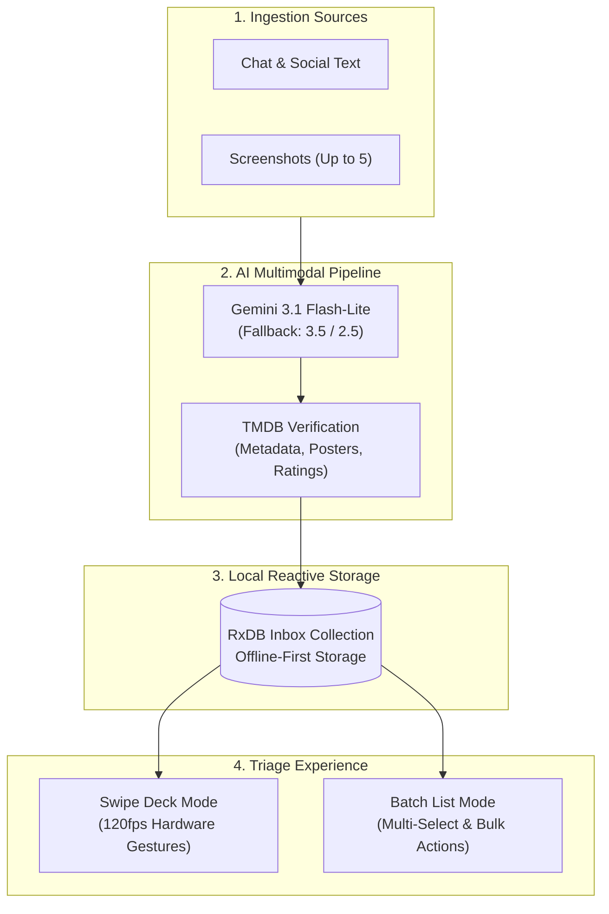
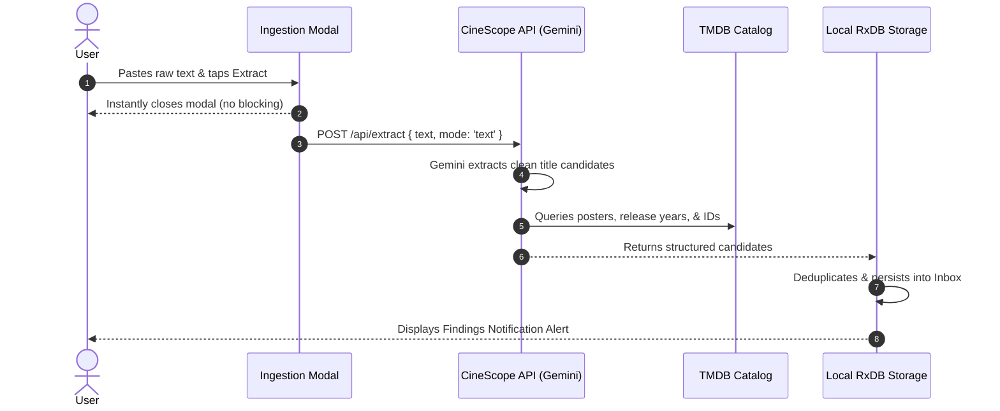
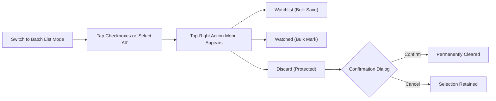

# AI Inbox & Gesture Queue

Discovering movie and TV recommendations across Reddit threads, WhatsApp chats, social media reels, or YouTube watchlists usually leads to manual typing, forgotten notes, or lost candidates.

CineScope solves this with the **AI Inbox**—a dedicated, offline-first staging queue powered by Google Gemini and TMDB. You can paste unformatted text or upload up to 5 screenshots; CineScope automatically parses the titles, verifies their metadata, and loads them into an interactive swipe deck for rapid triage.

---

---

## How It Works

The ingestion and triage pipeline processes media recommendations through four distinct stages:

---

## Use Case 1: Ingesting Raw Text & Notes

When friends recommend titles in messaging apps or you save a block of recommendations from Reddit or Letterboxd, you can paste the unstructured text directly into CineScope without formatting.

### Step-by-Step Walkthrough

1. Open the **Inbox** tab from the bottom navigation bar.
2. Tap the **+ Import** button in the top toolbar to open the ingestion modal.
3. Select the **Raw Text / Notes** segment.
4. Tap **Paste** to insert text from your clipboard, or type directly into the field (supports up to 10,000 characters).
5. Tap **Extract & Queue Titles**.

> [!NOTE]
> The ingestion modal dismisses immediately upon tapping **Extract & Queue Titles**. A pulsing extraction badge appears in the top toolbar while AI extraction runs in the background, allowing you to freely browse the app without waiting.

---

## Use Case 2: Multi-Screenshot Analysis

Often, movie recommendations appear as images: a screenshot of a Letterboxd watchlist, an Instagram story, or a video still with titles in the caption.

### Step-by-Step Walkthrough

1. Tap **+ Import** in the top toolbar and switch to the **Screenshot** segment.
2. Tap the dropzone to open your device's photo gallery, or drag and drop images directly.
3. Select up to **5 screenshots** (PNG, JPEG, WEBP).
4. Review the thumbnail strip:
   - Inspect selected image badges.
   - Tap the close icon on any individual thumbnail to remove it before processing.
5. Tap **Extract & Queue Titles**.

### Sequential Batch Queueing

When multiple screenshots are submitted, CineScope runs a sequential analysis queue:
- Each screenshot is analyzed by Gemini's multimodal vision model.
- Discovered titles are matched against TMDB for verified posters, genres, and ratings.
- Existing items in your Watchlist, Watched archive, or Inbox are automatically deduplicated.
- Upon completion, an **Analysis Findings Alert** summarizes total discovered titles, new additions, and skipped duplicates. Tapping **View in Inbox** switches directly to the list view.

---

## Use Case 3: Fluid Gesture Deck Triaging

The **Swipe Deck** mode transforms title triage into a tactile, rapid-fire card experience built with 120fps GPU-accelerated touch physics.

### Directional Gesture Guide

| Gesture | Direction | Action | Description |
| :--- | :--- | :--- | :--- |
| **Swipe Right** | Right (> 100px or fast fling) | **Save to Watchlist** | Moves item directly into your personal Watchlist. |
| **Swipe Left** | Left (< -100px or fast fling) | **Discard** | Removes item from the queue without saving. |
| **Swipe Up** | Up (< -90px or fast fling) | **Mark as Watched** | Moves item directly into your Watched history. |
| **Tap Scrim** | Single Tap on title area | **Open Detail Page** | Opens complete synopsis, cast, trailers, and streaming providers. |

### Visual Feedback & Performance

- **Directional Stamp Badges**: As you drag a card, high-contrast dynamic stamps (`WATCHLIST`, `DISCARD`, `WATCHED`) illuminate proportionally to your touch distance.
- **Hardware-Accelerated Exit**: Swiping off-screen triggers smooth 0.24s cubic-bezier acceleration curves with active haptic pulses.
- **Immediate State Commit**: Card actions write immediately to local RxDB storage with zero delayed toast races or visual flickering.

---

## Use Case 4: Batch List Mode & Safe Cleanup

For reviewing large queues or managing multiple titles at once, switch to **Batch List Mode** using the view toggle in the header.

### Multi-Select Actions

1. Tap individual item checkboxes, or tap **Select All** to highlight the entire queue.
2. A sticky **Top-Right Action Capsule** provides one-tap bulk operations:
   - **Watchlist**: Moves all selected titles into your Watchlist.
   - **Watched**: Marks all selected titles as Watched.
   - **Discard**: Prompts an explicit confirmation dialog before removing candidates.

### Accidental Deletion Protection

Because AI extraction and screenshot analysis require network requests and token processing, CineScope guards against accidental data loss:

- **Toolbar "Clear All" Button**: Located in the top header, this red capsule button prompts a confirmation dialog stating the exact count of unreviewed titles scheduled for deletion.
- **Bulk Discard Confirmation**: Whenever multiple items or all items are selected for discard, an `AlertController` modal verifies the action before modifying the database.
- Tapping **Cancel** preserves all items and selection states untouched.

---

## Technical Architecture & Resilience

The AI Inbox is engineered for speed, low token cost, and offline durability:

- **Gemini Model Cascade**: Requests prioritize `gemini-3.1-flash-lite` (500 free requests/day, 15 RPM), automatically falling back to `gemini-3.5-flash-lite` and `gemini-2.5-flash` during spikes in global demand.
- **Structured Error Handling**: HTTP 429 (Rate Limits) and HTTP 503 (High Demand) are caught and surfaced via friendly toasts explaining when to retry.
- **Local Persistence**: All candidate cards are stored locally in IndexedDB via RxDB, ensuring zero loading spinners when opening the app and full functionality even without an active internet connection.
