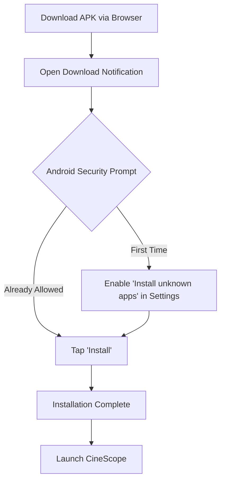

# Installation & Setup

CineScope is distributed as an optimized Android APK package directly from GitHub Releases. No accounts, API key configurations, or subscription signups are required to start tracking movies and TV series.

---

## System Requirements

- **Operating System**: Android 8.0 (Oreo / API Level 26) or higher.
- **Recommended**: Android 12+ for dynamic theme and gesture navigation integration.
- **Storage**: Minimum 50 MB free disk space for initial installation and local cache.
- **Network**: Internet connection is required for initial catalog browsing and AI search; all saved watchlists and local metadata remain fully functional offline.

---

## Downloading the APK

Choose one of two official download sources:

1. **Direct Latest APK Download**:
   Download the latest release package directly via [GitHub Releases Direct Download Link](https://github.com/r-a-j/cinescope/releases/latest/download/app-release-unsigned-signed.apk). This link automatically redirects to the newest APK build.
2. **Release Changelogs Page**:
   Visit the [GitHub Releases Page](https://github.com/r-a-j/cinescope/releases/latest) to inspect version release notes, changelogs, build artifacts, and release dates.

---

## Installing on Your Android Device

Because CineScope is distributed independently outside the Google Play Store, Android requires granting permission to install apps from your browser or file manager:

### Step-by-Step Instructions

1. **Download the File**: Tap the download link on your Android device. Your browser may display a standard security notice: *"File might be harmful. Do you want to download app-release-unsigned-signed.apk anyway?"*. Tap **Download anyway**.
2. **Open the Package**: Once the download completes, tap the notification or navigate to your device's **Downloads** folder using a file manager.
3. **Allow Installation**: If prompted with *"For your security, your phone is currently not allowed to install unknown apps from this source"*:
   - Tap **Settings**.
   - Toggle the switch to **Allow from this source**.
   - Tap the back button to return to the installer.
4. **Complete Installation**: Tap **Install**. Once finished, tap **Open** to launch CineScope.

---

## First Launch & Zero-Config Setup

When you first launch CineScope, the application performs automatic initialization in under 500 milliseconds:

- **Local Storage Creation**: Initializes an encrypted, offline-first RxDB database instance in your device's local storage.
- **Zero API Key Configuration**: You do **not** need to register for The Movie Database (TMDB) or Google AI Studio accounts. The application delegates requests to a secure backend gateway that manages upstream rate limits and credentials.
- **Immediate Offline Preparedness**: As you browse titles and add them to your watchlist, entries are cached for offline retrieval.

### First-Run App Tour

On a fresh installation, CineScope loads the initial Discover feed before opening a guided spotlight tour of its main sections and shortcuts. Use **Next** and **Back** to move through the tour, or **Skip tour** to close it. If the feed cannot load, retry from Discover; the automatic tour waits until the feed loads. The tour only appears automatically once; existing installations are not prompted after updating.

To revisit the walkthrough later, open **Settings → Help & Tutorials**. Choose **Full App Tour** or expand a category to launch a focused tutorial. Tutorials are grouped into **Explore & Discover**, **Your Library**, and **Recommendations**. The **Your Library → Franchise Tracker** walkthrough explains how to track a saga, read its progress, use the timeline filters, and find the next title to watch. **Universe Merge & Unmerge** explains how related sagas are folded under a universe in Archive and why that does not change the universe's canon or progress. This walkthrough includes hands-on merge guidance when a merge-eligible universe is already tracked.
