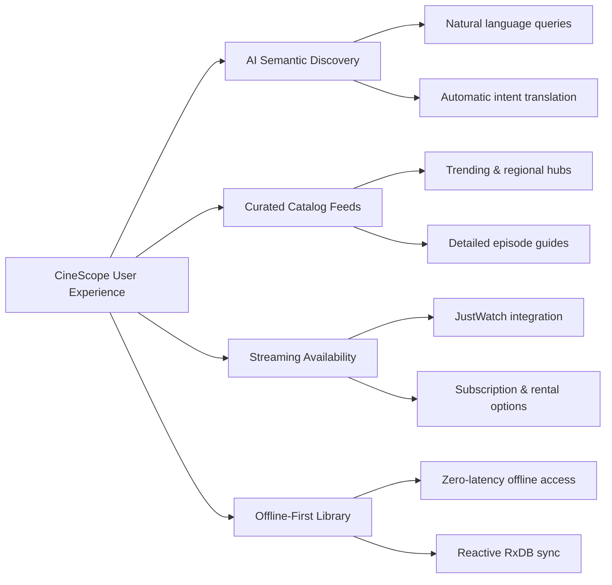

# CineScope User Guide

CineScope is an offline-first cinematic tracking and discovery mobile platform built for film and television enthusiasts. It combines natural-language semantic discovery powered by Google Gemini AI with reactive local persistence, real-time streaming availability across global providers, and high-density watchlist management.

This guide provides step-by-step instructions for installing the app, discovering content, searching with natural language, and managing your personal library.

---

## Core Capabilities

---

## Guide Directory

Explore each section of the user guide:

| Section | Description |
| :--- | :--- |
| **[Installation & Setup](./getting-started)** | Download the latest APK release, install on Android, and initialize offline storage without API key setup. |
| **[Gemini AI Smart Search](./ai-smart-search)** | Formulate conversational movie queries translated by Google Gemini into structured execution graphs. |
| **[Discover Hub & Curated Feeds](./discover-and-feeds)** | Explore dynamic trending hero backdrops, swimlanes, and dedicated Regional Indian Cinema hubs. |
| **[Media Details & Streaming](./media-details-and-streaming)** | Inspect cast carousels, season-by-season episode guides, and real-time streaming provider availability. |
| **[Watchlist & Offline Library](./watchlist-and-offline)** | Manage your collection with high-density 4-column poster grids, optimistic state controls, and RxDB offline storage. |

---

## Key Highlights for Users

- **Zero Configuration Required**: You do not need to register for third-party developer accounts, obtain TMDB API tokens, or manage Gemini API keys. The app connects securely through a dedicated serverless gateway.
- **Offline Reliability**: Your watchlists, watched history, and favorites are stored locally on your device using RxDB and IndexedDB. You can access and manage your collection on airplanes or in low-connectivity environments.
- **Privacy First**: Tracking data and collection state remain on your local device.
