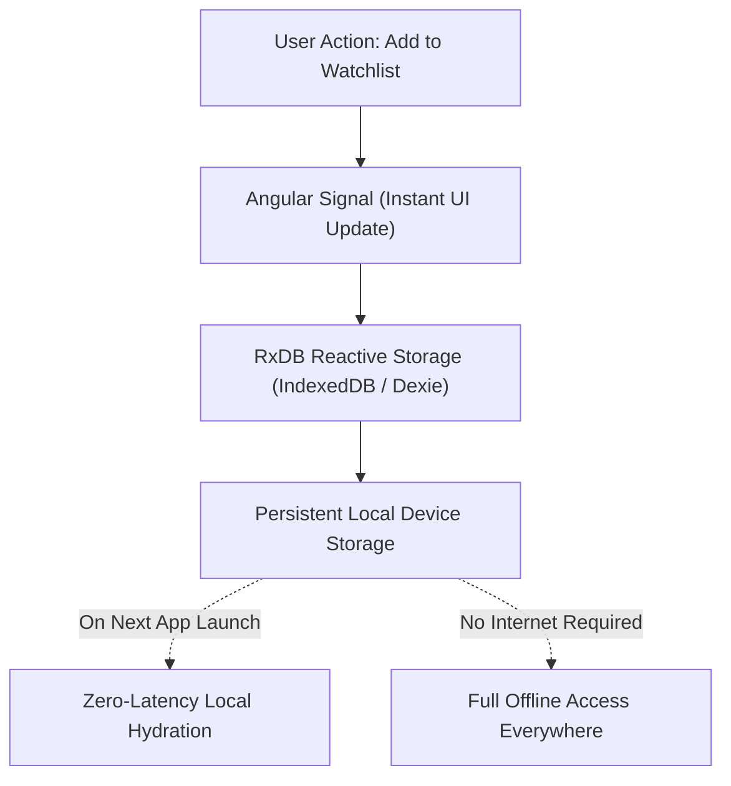

# Watchlist & Offline Archive

CineScope is built from the ground up on an **offline-first** architectural philosophy. Rather than relying on cloud accounts or constant network connectivity, your personal library is stored directly on your device with reactive state synchronization.

---

## State Controls: Watchlist, Watched & Favorites

Every movie and TV series detail view includes prominent, one-tap state controls:

  
  
<b>Figure 1:</b> Optimistic state action controls for Watchlist, Watched, and Favorite status with instant UI feedback.

### State Types

1. **Watchlist**: Titles you plan to watch in the future. Marked with a primary highlighted button.
2. **Watched**: Titles you have completed. Tapping marks the entry as watched and logs it into your chronological viewing history archive.
3. **Favorites**: Titles you cherish and want pinned for fast reference.

### Optimistic UI Feedback

State updates happen **instantaneously** without network spin-loaders. When you tap **Watchlist** or **Watched**, the button updates in under 16ms, while background sync writes to the local RxDB database.

---

## High-Density 4-Column Poster Grid

The **Archive** tab organizes your saved collection in a high-density, 4-column poster grid designed for fluid browsing of large libraries:

  
  
<b>Figure 2:</b> High-density 4-column grid rendering over 300 tracked titles with smooth, stutter-free performance.

### Key Advantages of the Grid Layout

- **High Information Density**: View more titles per screen without excessive vertical scrolling.
- **Sub-Frame Hydration**: Posters load instantly from the local database cache rather than reloading from the internet each time.
- **Collection Badges**: Visual indicator tags distinguish movies from multi-season TV series at a glance.

---

## Watched History Archive

Keep an organized log of everything you have watched over time:

  
  
<b>Figure 3:</b> Watched history archive featuring chronological logging and quick-filter category tabs.

### Archive Organization

- **Filter Tabs**: Toggle between **All Saved Items**, **Watchlist**, **Watched**, and **Favorites** with a single swipe or tap.
- **Local Search**: Instantly filter your saved collection by title without making a network request.
- **Quick Removal**: Tap any card to toggle states or remove items from your collection.

---

## Offline-First Reliability (RxDB Architecture)

Traditional streaming and media apps display blank screens or connection error banners when offline. CineScope takes a fundamentally different approach:

- **Zero-Latency Launches**: Your saved library appears the instant the app opens.
- **In-Flight & Commute Friendly**: Review your watchlist, inspect episode numbers, or read saved movie synopses on flights, subways, or areas without cellular coverage.
- **Data Privacy**: Your personal tracking habits are stored directly on your device rather than monetized or sold to third-party tracking networks.
